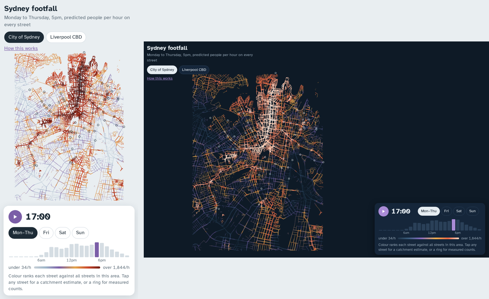

# Sydney footfall

Neural-network estimates of pedestrian volume, by hour, for every street in the City of Sydney and Liverpool CBD. The models are trained on every open Sydney walking-count dataset that was still reachable in October 2026.

**Live demo:** `docs/index.html` is a single self-contained HTML file. Open it locally, or turn on GitHub Pages (Settings → Pages → `main` / `docs`).



## What's in here

| | |
|---|---|
| `src/fetch_data.py` | Downloads council count data and Open-Meteo hourly weather |
| `src/fetch_osm.py` | Downloads OpenStreetMap POIs, transit stops and the walkable street network (Overpass, with mirror fallback) |
| `src/build_dataset.py` | Harmonises the sources into one table of ~400k site-hours across 137 locations |
| `src/features.py` | 46 spatial context features per point: POI counts by category within 100/250/500 m, street length by class, and distance to rail, light rail, bus and pedestrian ways |
| `src/temporal.py` | Hour harmonics, day type (Mon–Thu / Fri / Sat / Sun / public holiday), season, trend, COVID lockdown and restriction flags, weather |
| `src/model.py` | `FootfallNet` (spatio-temporal) and `ShortTermForecaster` (next 24 h) |
| `src/train_footfall.py` | Site-grouped cross-validation, temporal holdout and baselines, plus the final 3-seed ensemble |
| `src/train_forecaster.py` | Residual GRU forecaster for continuously counted sites |
| `src/predict.py` | Point predictions from the CLI, and export of street-segment predictions for the web demo |
| `models/` | Trained weights (`footfall_seed*.pt`, `forecaster.pt`) and evaluation JSON |
| `web/`, `docs/` | Demo template; built single-file demo (`docs/index.html` for GitHub Pages) |

```bash
pip install -r requirements.txt
make data dataset train web      # ~15 min on a laptop CPU; raw data ~120 MB
cd src && python predict.py --lat -33.8737 --lon 151.2069 --daytype sat
```

## Data sources

| Source | What | Coverage | Used |
|---|---|---|---|
| City of Sydney: [Walking count surveys](https://data.cityofsydney.nsw.gov.au/datasets/cityofsydney::walking-count-surveys) and [sites](https://data.cityofsydney.nsw.gov.au/datasets/cityofsydney::walking-count-sites) | ~120 sites, 6am–midnight, one weekday and one weekend day each March (or May) and October. Each hour is a 10-minute sample ×6 (Gehl method), fair weather only | 2013–2026, 5,453 site-days | ✅ |
| City of Sydney: [Automatic hourly pedestrian count](https://data.cityofsydney.nsw.gov.au/datasets/cityofsydney::automatic-hourly-pedestrian-count) | 4 CBD sensors (Bridge, Elizabeth, Market, Park St), hourly. Park St's documented half-count fault (3 Jul – 11 Nov 2022) removed | Feb 2020 – Jul 2025 | ✅ |
| Liverpool City Council: [Devices, people and vehicles counting](https://liverpool-city-council-westernparklands.opendatasoft.com/explore/dataset/ncounter/) | 13 CCTV camera people counters, hourly | Jan 2023 – Sep 2024 (later data is empty) | ✅ |
| Liverpool nCounter devices (same dataset) | WiFi/Bluetooth device detections | 2023–2024 | ❌ counts phones, not people |
| TfNSW: Smart Cities Macquarie Park | Pedestrian sensors | 2019–2020 | ❌ host offline; Wayback copies exist |
| TfNSW: Smart Pedestrian Project (Liverpool, UOW) | Sensor API | – | ❌ API offline |
| OpenStreetMap via Overpass | POIs, stations, street network | Oct 2026 snapshot | ✅ features |
| Open-Meteo historical archive | Hourly temperature, rain, cloud, wind | 2013–2026 | ✅ features |
| `holidays` package | NSW public holidays | – | ✅ features |

Survey rows carry no exact date. Weekday surveys are encoded as Mon–Thu. The weekend survey day isn't published, so it is encoded as half Saturday, half Sunday. Their weather is set to dry-hour climatology for that month and hour, because surveys are only run in fair weather.

## Model

**FootfallNet** predicts `log1p(people per hour)`. It has three parts:
- A spatial tower: an MLP over the 46 OSM features, with input noise for robustness.
- A temporal tower: an MLP over the 28 time and weather features.
- A fusion head over `[spatial, temporal, spatial × temporal]`. The interaction term lets office districts peak at commute hours while nightlife strips peak late on Saturday.

A per-source scale and bias absorbs the different counting conventions: two-way survey cross-sections, sensor screen lines, and single-camera fields of view. Predictions are reported in the survey convention.

Training uses Huber loss with per-row weights of 1/√(rows per site), so the 4 long-running sensors don't swamp the 120 survey sites. The final model is an ensemble of 3 seeds.

**ShortTermForecaster** is for sites with a live counter. It starts from the seasonal-naive forecast (the same hours one week earlier) and learns a correction from two inputs: a GRU over the past 7 days, and tomorrow's calendar and weather.

## Results

**Unseen locations** (5-fold cross-validation grouped by site, so each test site is never seen in training):

| City of Sydney survey sites | log R² | median daily error | daily within ±25% | site ranking (Spearman) |
|---|---|---|---|---|
| Time-of-day profile only (no location) | 0.14 | 72% | 17% | −0.18 |
| Gradient boosting, same features | 0.57 | 48% | 25% | 0.81 |
| **FootfallNet** | **0.63** | **42%** | **28%** | **0.88** |

It orders locations well, but an individual unseen street's daily total is typically off by about 40%. Unseen Liverpool cameras are not predictable (log R² 0.03), because each camera watches an idiosyncratic patch of footpath.

**Future periods at known locations** (trained before Jul 2024, tested after):

| | median daily error | log R² |
|---|---|---|
| City of Sydney surveys (Spring 2024 – Autumn 2026) | 21% | 0.86 |
| City of Sydney sensors | 13% | 0.83 |
| Liverpool cameras | 21% | 0.72 |

**Next-24-hour forecasting** for live counters, on the last 20% of days per site:

| | hourly log RMSE | median daily error |
|---|---|---|
| Same hour last week | 0.90 | 9.5% |
| Residual GRU | **0.75** | 10.0% |

The GRU sharpens the hour-by-hour shape. For daily totals, last week is already hard to beat.

Full metrics are in `models/eval_footfall.json` and `models/eval_forecaster.json`.

### Known limitations

- Training sites are concentrated on busy CBD streets, so quiet residential streets have little support in the data. Use the map as **relative** busyness.
- The OSM features describe October 2026. Earlier years are modelled with today's land use plus a trend term.
- No school-holiday, event or construction features yet.
- Liverpool has only 13 cameras in a 1 km² area, so predictions elsewhere in Western Sydney are extrapolation.
- No directional data except Liverpool camera names, so the model predicts volume, not flow direction.

## Visualisation ideas for commercial use

The demo implements the first two.

1. **Street heat map with a time scrubber.** Every street segment is coloured by predicted volume, with a 24-hour "city pulse" histogram that doubles as the slider, and day-type toggles.
2. **Catchment scorer.** Tap a point to see the busiest street within 200 m, the length-weighted typical street, and the hourly profile. Useful for retail site selection and lease comparisons.
3. **Frontage / billboard impressions.** Volume past a specific frontage by daypart, for outdoor-advertising pricing.
4. **Trading-hours fit.** Overlay opening hours (from OSM) on the predicted profile to find strips where shops close while footfall is still high.
5. **Event uplift and anomaly view.** Compare live counter data with the forecaster to measure event or construction impact.
6. **Arrow flow map.** Needs directional counts. A defensible interim is to route trips from stations to POIs over the street graph and label the result as *modelled* flow.
7. **Change map.** Show the year-on-year difference in predicted footfall (e.g. after the light rail or Metro openings), driven by the trend term and the survey history.

## Data and licences

Code is MIT. The City of Sydney data hub states that its data is published under Creative Commons licences unless otherwise stated, but these specific datasets list "licence not specified". The Liverpool dataset lists no licence. This repository therefore **does not redistribute raw data**: run `make data` to fetch it.

Model weights and the aggregated street predictions in `web/` are derived works. Check the publishers' terms before commercial use. OpenStreetMap data is © OpenStreetMap contributors under ODbL. Weather is from Open-Meteo (CC BY 4.0).
